<div align="center">

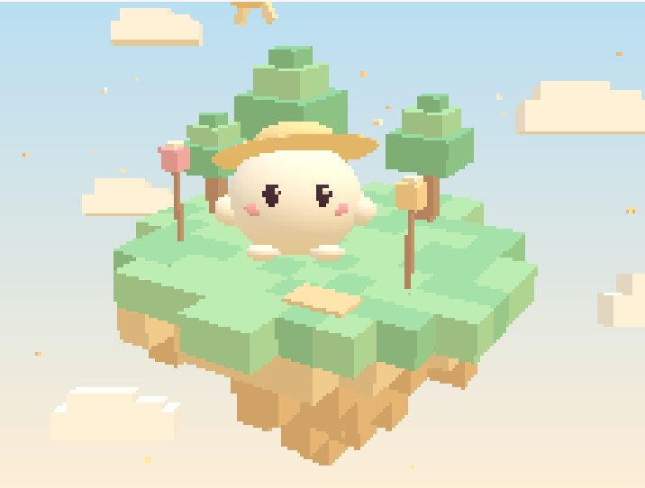

# Isla Mochi

**Tu ciclo, como las estaciones de una pequeña isla.**

Una guía personal de cómo te puedes sentir, física y emocionalmente, en cada momento del ciclo, y qué te puede ayudar.

</div>

Isla Mochi **no es un tracker**: para seguir tu regla ya tienes Clue o tu app de siempre. Aquí vienes a entenderte mejor. La app solo necesita saber en qué fase estás, y a partir de ahí Mochi te cuenta qué puedes notar hoy y qué te puede sentar bien.

> El nombre es provisional. El contenido es informativo y no sustituye a un profesional sanitario. No sirve como método anticonceptivo.

## Capturas

<table>
  <tr>
    <td width="33%">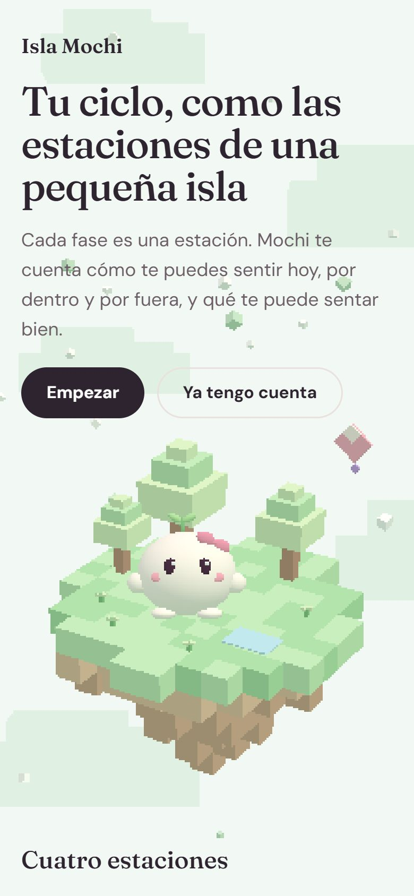</td>
    <td width="33%">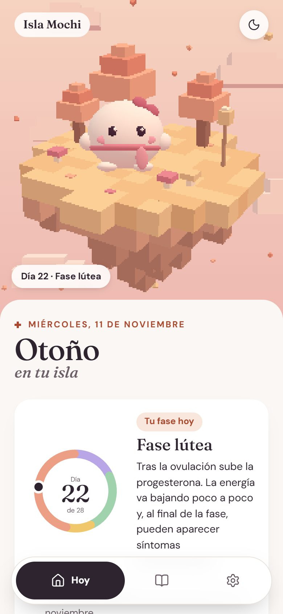</td>
    <td width="33%">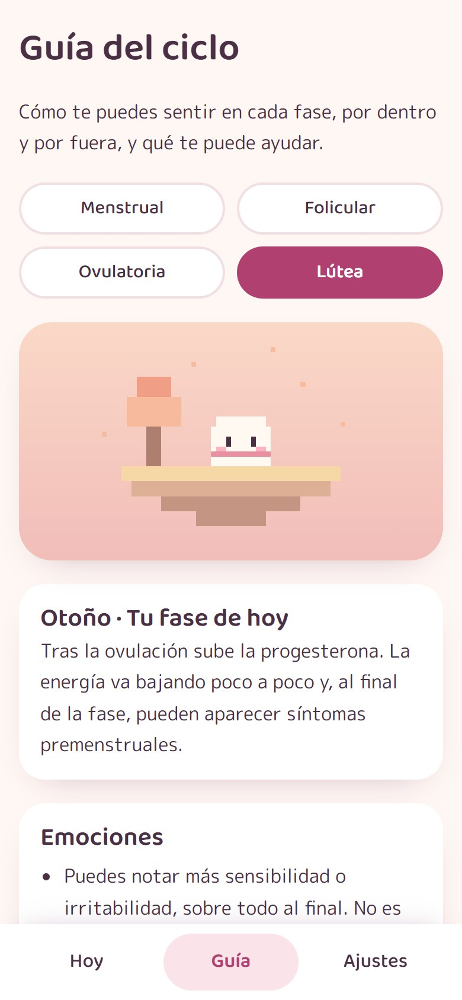</td>
  </tr>
  <tr>
    <td align="center"><sub>Portada</sub></td>
    <td align="center"><sub>Hoy: tu fase y cómo te puedes sentir</sub></td>
    <td align="center"><sub>Guía de las 4 fases</sub></td>
  </tr>
  <tr>
    <td>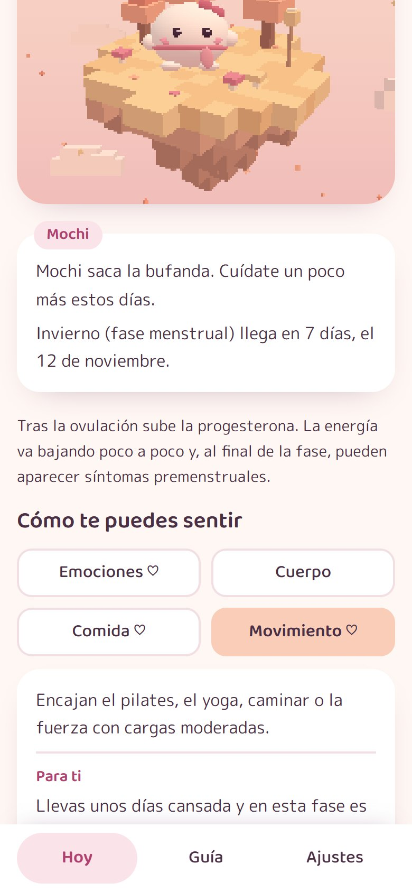</td>
    <td>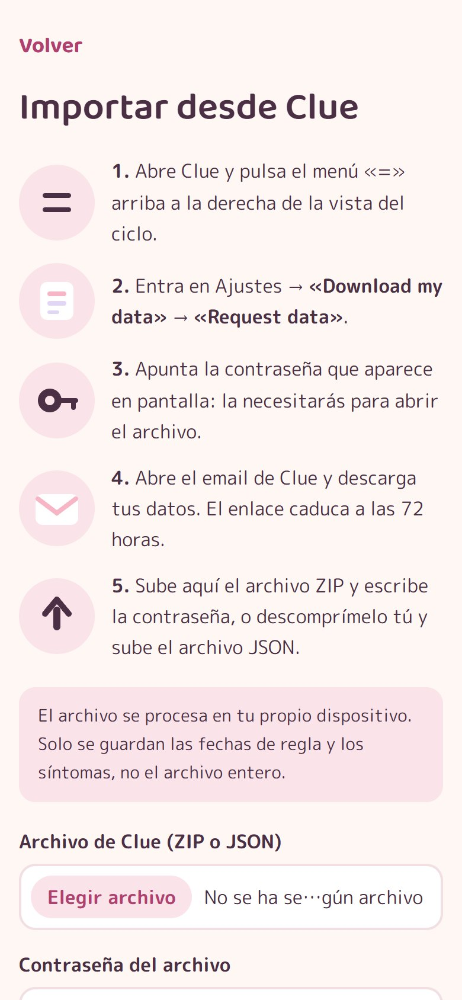</td>
    <td>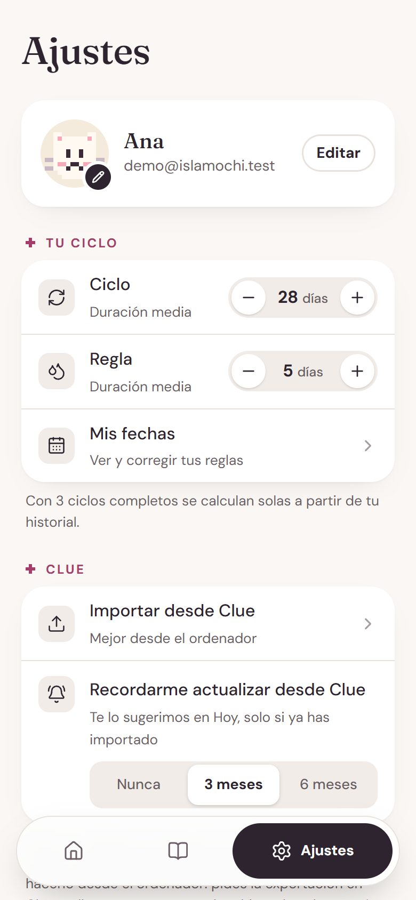</td>
  </tr>
  <tr>
    <td align="center"><sub>Consejos «Para ti»</sub></td>
    <td align="center"><sub>Importar desde Clue</sub></td>
    <td align="center"><sub>Avisos y cuenta</sub></td>
  </tr>
</table>

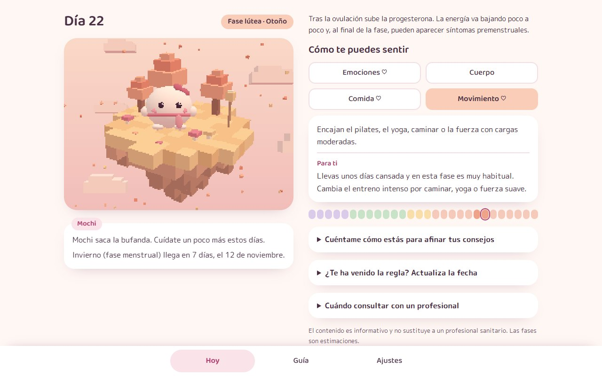

## Las cuatro estaciones

Cada fase es una estación de la isla, y Mochi cambia con ella: más tranquilo y arropado en invierno y otoño, más activo en primavera y verano.

<table>
  <tr>
    <td width="25%"></td>
    <td width="25%">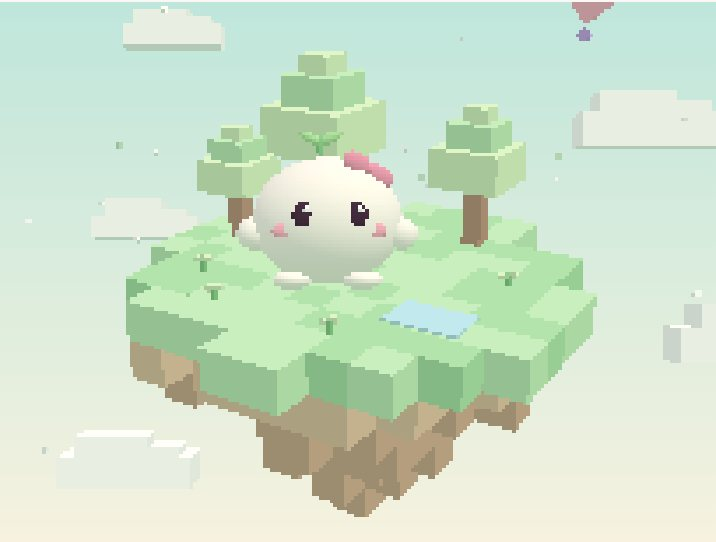</td>
    <td width="25%"></td>
    <td width="25%">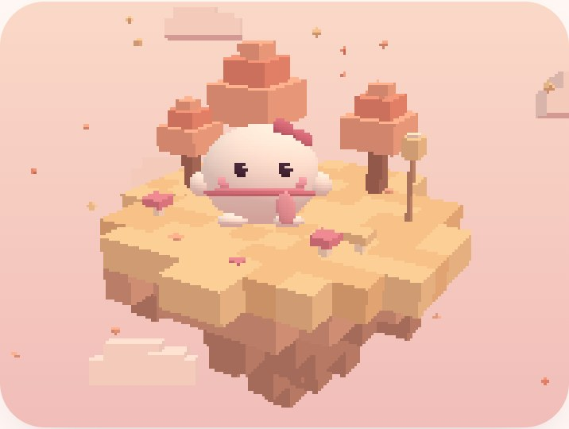</td>
  </tr>
  <tr>
    <td align="center"><sub><b>Invierno</b><br />Menstrual</sub></td>
    <td align="center"><sub><b>Primavera</b><br />Folicular</sub></td>
    <td align="center"><sub><b>Verano</b><br />Ovulatoria</sub></td>
    <td align="center"><sub><b>Otoño</b><br />Lútea</sub></td>
  </tr>
</table>

## Cómo funciona

1. **Le dices dónde estás.** Indicas tu última regla y tus duraciones medias, o importas tu historial de Clue. El archivo se procesa en tu dispositivo y solo se guardan fechas de regla y síntomas.
2. **Mochi calcula tu fase.** Estima en qué día y fase estás, y avisa si tus ciclos son irregulares o si hay retraso.
3. **Lees cómo te puedes sentir.** Cuatro bloques con información y consejos: emociones, cuerpo, comida y movimiento. En la Guía tienes las 4 fases para leerlas con calma.
4. **Si quieres, afinas los consejos.** Puedes contar cómo estás, y es opcional. Si algo se repite, aparece un consejo «Para ti». Si un síntoma vuelve en la misma fase de varios ciclos, Mochi te lo avisa.
5. **Recibes avisos, si los activas.** Por email o notificación, cada día o solo al cambiar de estación. Los títulos no mencionan tu ciclo, por si se ven en la pantalla de bloqueo.

Mochi es 3D y está hecho solo con código, sin modelos ni texturas. Respira, parpadea, te sigue con la mirada y da un brinco si lo tocas.

## Consejos con IA

Si tu ordenador puede, Mochi te escribe consejos a tu medida con una IA gratuita que se ejecuta **dentro de tu navegador**, con [WebLLM](https://webllm.mlc.ai) y WebGPU. No hay servidores de IA, claves ni costes.

<table>
  <tr>
    <td width="50%">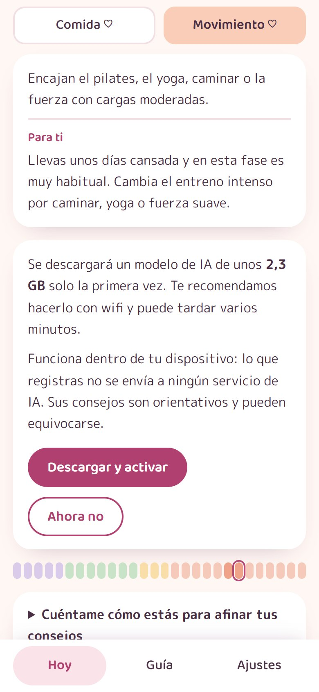</td>
    <td width="50%">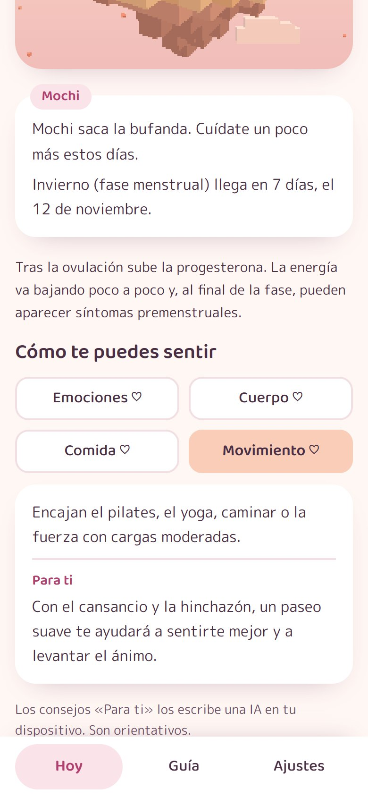</td>
  </tr>
  <tr>
    <td align="center"><sub>Aviso antes de descargar</sub></td>
    <td align="center"><sub>Consejo «Para ti» escrito por la IA</sub></td>
  </tr>
</table>

### Cómo funciona

1. **La activas tú.** Pulsas «Activar consejos con IA» y la app te avisa antes del tamaño de la descarga, unos 2,3 GB, solo la primera vez.
2. **Le cuentas cómo estás.** Sin datos no hay nada que personalizar, así que el modelo ni se carga.
3. **Adapta, no inventa.** Para cada bloque recibe un consejo ya revisado y lo adapta a tus síntomas, ánimo y energía de la última semana. Tus notas nunca se usan.
4. **Todo se valida.** Si nombra medicamentos o diagnósticos, cambia de idioma, se pasa de largo o anima a entrenar fuerte a quien lleva días sin energía, ese bloque se descarta.
5. **Si falla, no se nota.** Sin WebGPU, sin memoria o con una respuesta no válida, se usan los consejos por reglas. La app funciona igual sin IA.

Los consejos se guardan en el dispositivo y solo se generan de nuevo si cambia el día o lo que has registrado. Mientras Mochi escribe, la escena 3D se pausa para dejarle la GPU. En Ajustes puedes desactivarla y borrar el modelo.

**Lo que nunca hace la IA:** decidir sobre señales de alarma. Si registras dolor o sangrado muy fuertes, el modelo no se usa: el aviso de consultar con un profesional sale de reglas fijas. Los emails y notificaciones tampoco usan IA.

### Por qué este modelo, y por qué no en el móvil

El modelo se eligió probando 5 opciones reales, en español, con los mismos casos:

| Modelo | Descarga | Resultado |
|---|---|---|
| Qwen3.5 0.8B | 447 MB | Incoherente |
| Gemma 3 1B | 602 MB | Robótico, confunde datos y género |
| Qwen3 1.7B | 984 MB | Repite los datos en lugar de aconsejar |
| Qwen3.5 2B | 1,1 GB | Natural, pero con consejos equivocados, como entrenar intenso con energía mínima |
| **Qwen3 4B** | **2,3 GB** | **Coherente y bien adaptado** |

Los que caben en un móvil fallan justo donde importa, así que se priorizó la seguridad: Qwen3 4B necesita unos 3,4 GB de memoria de GPU y se ofrece solo en ordenadores con WebGPU y `shader-f16`. En móviles y tablets no aparece el botón y se usan las reglas.

En un portátil con una RTX 3050 cargó en unos 20 segundos desde la caché y tardó unos 2 minutos en escribir los 4 bloques la primera vez, porque compila el código de la GPU. Un modelo tan pequeño puede equivocarse: los consejos son orientativos y la app lo indica.

## Privacidad

Son datos de salud, una categoría especial del RGPD:

- Consentimiento explícito al registrarse, y solo se guarda lo necesario.
- Cada usuaria solo puede acceder a sus propias filas, con Row Level Security y tests que lo comprueban.
- Puedes exportar tus datos y borrar tu cuenta desde Ajustes.
- Las fuentes van alojadas en la propia app: no se envía tu IP a Google.

## Estado

| Fase | Contenido | Estado |
|---|---|---|
| 1 | Base, Supabase, auth, bienvenida manual, lógica del ciclo, pantalla Hoy y escena 3D | Hecha |
| 2 | Importar desde Clue, registro diario, Mi ciclo y personalización por reglas | Hecha |
| 3 | PWA, push, emails y cron. Exportar y borrar cuenta | Hecha, sin probar con servicios reales |
| 4 | Consejos con IA en el navegador (WebLLM) | Hecha, solo en ordenadores con WebGPU |

## Stack

| Tecnología | Uso |
|---|---|
| React + Vite + TypeScript | Interfaz y build |
| React Three Fiber + drei + Three.js | Escena 3D |
| React Router | Rutas |
| Supabase | Auth (magic link y código) y Postgres con Row Level Security |
| WebLLM + Qwen3 4B | Consejos con IA dentro del navegador, sin servidor |
| zip.js | Abrir en el navegador el ZIP con contraseña de Clue |
| Vitest + PGlite | Tests de la lógica y de las políticas RLS |
| Resend | Emails de los avisos |
| web-push + service worker | Notificaciones y PWA instalable |
| Vercel | Hosting, funciones de `api/` y cron diario |

## Empezar en local

Requisitos: Node.js 20 o superior. Los comandos son para PowerShell.

```powershell
npm install
npm run dev
```

La web queda en `http://localhost:5173`.

**Sin claves de Supabase arranca en modo demo:** los datos se guardan en la pestaña del navegador, no se envía ningún correo y vale cualquier código. En la pantalla Hoy aparece una barra para saltar a cualquier estación o simular un retraso. Este modo solo existe en desarrollo y no llega al build de producción.

| Script | Qué hace |
|---|---|
| `npm run dev` | Servidor de desarrollo |
| `npm run build` | Comprueba los tipos y genera `dist/` |
| `npm run preview` | Sirve el build para probarlo |
| `npm test` | Tests de lógica y RLS |
| `npm run lint` | Revisa el código con ESLint |

## Conectar Supabase

1. Crea un proyecto en [supabase.com](https://supabase.com). **Elige una región de la UE**: la región no se puede cambiar después.
2. Abre *SQL Editor*, pega el contenido de `supabase/migrations/20261105000000_init.sql` y ejecútalo.
3. En *Authentication > URL Configuration*, pon `http://localhost:5173` en *Site URL* y añade `http://localhost:5173/**` en *Redirect URLs*. Al desplegar, añade también la URL de producción.
4. En *Authentication > Emails*, edita las plantillas **Magic Link** y **Confirm signup** y añade el código, por ejemplo: `<p>Tu código: {{ .Token }}</p>`. Hace falta porque en iPhone el enlace se abre en Safari y no dentro de la app instalada.
5. Crea tu archivo local y rellena los dos valores, que están en *Project Settings > API*:

```powershell
Copy-Item .env.example .env.local
```

6. Reinicia `npm run dev`. El modo demo se desactiva solo.

> Hasta conectar un SMTP propio, Supabase solo envía 2 correos por hora y únicamente a miembros de tu organización. Sirve para que pruebes tú, no para usuarias reales.

## Variables de entorno

| Variable | Dónde | Para qué |
|---|---|---|
| `VITE_SUPABASE_URL` | `.env.local` y Vercel | URL del proyecto |
| `VITE_SUPABASE_ANON_KEY` | `.env.local` y Vercel | Clave pública. Lo que protege los datos es RLS |
| `VITE_VAPID_PUBLIC_KEY` | `.env.local` y Vercel | Clave pública de notificaciones |
| `SUPABASE_SERVICE_ROLE_KEY` | **Solo Vercel** | Se salta RLS. Para el cron y borrar cuentas |
| `VAPID_PRIVATE_KEY` | **Solo Vercel** | Clave privada de notificaciones |
| `VAPID_SUBJECT` | **Solo Vercel** | Contacto, por ejemplo `mailto:hola@tudominio.es` |
| `RESEND_API_KEY` | **Solo Vercel** | Clave de Resend |
| `RESEND_FROM` | **Solo Vercel** | Remitente con dominio verificado |
| `APP_URL` | **Solo Vercel** | URL pública, sin barra final |
| `CRON_SECRET` | **Solo Vercel** | Protege el cron. Vercel lo envía solo |
| `UNSUBSCRIBE_SECRET` | **Solo Vercel** | Firma los enlaces de baja |

Todo lo que lleva el prefijo `VITE_` llega al navegador: nunca pongas ahí una clave secreta.

## Base de datos

Las migraciones están en `supabase/migrations/`.

| Tabla | Contenido |
|---|---|
| `profiles` | Duraciones medias, avisos, zona horaria y consentimiento. La crea un trigger al registrarse |
| `periods` | Fechas de regla. Una por usuaria y día, así reimportar no duplica |
| `daily_logs` | Registro diario: síntomas, ánimo, energía y notas |
| `push_subscriptions` | Dispositivos con avisos push |
| `notification_log` | Avisos enviados. Solo la usa el servidor |

Cada usuaria solo puede leer y escribir sus filas. Todo cuelga de `auth.users` con `on delete cascade`, de modo que borrar la cuenta borra sus datos. `tests/rls.test.ts` ejecuta las migraciones reales en un Postgres en memoria y comprueba este aislamiento.

## Lógica del ciclo

Vive en `src/lib/cycle.ts`, sin dependencias de interfaz, para poder usarla también en el cron.

- Las fechas son cadenas `YYYY-MM-DD`, sin horas, para evitar errores de zona horaria.
- La duración media se calcula con los últimos 6 ciclos cuando hay al menos 3 completos. Si no, se usa la que indicó la usuaria.
- La ovulación se estima en (duración − 14) ± 1 día. Con ciclos cortos y reglas largas, la ventana empieza el día después de la regla y la fase folicular puede quedarse sin días.
- Estados especiales: `late` (retraso), `stale` (más de 30 días de retraso, pide actualizar), `no_data`, y aviso de ciclo irregular si la variación pasa de 7 días.

## Personalización por reglas

Vive en `src/lib/personalize.ts`, sin IA ni red, y los textos en `src/content/personalTips.ts`.

- **Reglas:** si una señal aparece al menos 2 de los últimos 5 días, se añade un consejo «Para ti». Por ejemplo, cansancio varios días en fase lútea muestra los consejos de energía de esa fase.
- **Patrones:** un síntoma registrado en la misma fase de 2 ciclos anteriores se avisa en el bloque Cuerpo.
- **Alarma:** registrar dolor o sangrado muy fuertes muestra durante 3 días la recomendación de consultar con un profesional.

## Importar desde Clue

Todo ocurre en el navegador. `src/lib/clue/read.ts` abre el ZIP con contraseña o el JSON y solo descifra `measurements.json`. `src/lib/clue/parser.ts` extrae las fechas de regla y una lista cerrada de síntomas (`SYMPTOM_MAP`): el resto, como vida sexual, medicación o peso, se descarta sin guardarse.

El formato de Clue no está documentado: el parser sale de una exportación real de noviembre de 2026, así que puede necesitar ajustes si Clue lo cambia. Los días de regla separados por hasta 2 días vacíos cuentan como la misma regla, y lo importado nunca sustituye a lo que ya estaba registrado.

## Avisos

`vercel.json` llama una vez al día, sobre las 7:00 UTC, a `api/cron/daily.ts`, protegido con `CRON_SECRET`. Para cada usuaria calcula la fase en su zona horaria y envía email, push o ambos, sin IA: contenido base más las reglas de personalización.

- **Discreción:** el asunto y el push se ven en la pantalla de bloqueo, así que usan la metáfora de la isla y nunca mencionan el ciclo. Hay un test que lo comprueba. Las notas personales ni se leen.
- **Sin duplicados:** cada envío se reserva antes en `notification_log`. Si el cron se repite, no se envía dos veces. Si un envío falla, se libera para reintentarlo.
- **Límite de Resend:** como mucho 80 emails al día, con prioridad para los cambios de estación. El resto del cupo gratuito queda para los accesos por email.
- **Baja:** cada email lleva un enlace firmado. Abrirlo solo pregunta, porque algunos correos abren los enlaces solos.

Genera las claves de notificaciones y los secretos así:

```powershell
npx web-push generate-vapid-keys
```

```powershell
node -e "console.log(require('crypto').randomBytes(32).toString('hex'))"
```

`npm run dev` no ejecuta `api/` ni el service worker. Para probar las funciones usa `npx vercel dev`, y para la PWA, `npm run build` y `npm run preview`.

## Estructura

```
├── api/                     Funciones de Vercel: cron, borrar cuenta y baja de emails
│   └── _lib/                Lógica de avisos, plantilla y conexiones (no son rutas)
├── public/                  Favicon e iconos de la PWA
├── supabase/migrations/     Tablas, RLS y trigger de registro
├── tests/                   Tests del ciclo, reglas, Clue y RLS
└── src/
    ├── components/          DialogBox, AdviceBlocks, CycleBar, SkyPanel, StaticIsland...
    ├── content/             phases.ts, personalTips.ts, symptoms.ts y legal.ts
    ├── hooks/               useSession, useCycleData, useVisible, useReveal
    ├── lib/                 cycle.ts, personalize.ts, format.ts, clue/ y ai/
    ├── pages/               Landing, Auth, Onboarding, Today, Guide, MyCycle, ImportClue, Install, Settings, Privacy
    ├── services/            supabase.ts, auth.ts, data.ts, push.ts, account.ts y demo.ts
    ├── sw.ts                Service worker: caché de la web y notificaciones
    ├── styles/index.css     Variables en :root y todos los estilos
    └── three/               Scene, Island, Mochi, Floaters, Burst, seasons, shapes, support
```

## Personalizar

| Qué quieres cambiar | Dónde |
|---|---|
| Colores y tipografías | Variables `:root` y `[data-phase]` en `src/styles/index.css` |
| Consejos de cada fase | `src/content/phases.ts` |
| Consejos personalizados | `src/content/personalTips.ts` |
| Prompt y validación de la IA | `src/lib/ai/advice.ts` |
| Síntomas y ánimos | `src/content/symptoms.ts`. Los ánimos también están en el `check` de `daily_logs.mood` |
| Colores de cada estación y energía de Mochi | `src/three/seasons.ts` |
| Aspecto y ropa de Mochi | `src/three/Mochi.tsx` |
| Objetos de la isla | `Props` en `src/three/Island.tsx` |
| Tamaño del píxel y fps | `PIXEL_SIZE` y `FPS` en `src/three/Scene.tsx` |
| Responsable de la política de privacidad | `src/content/legal.ts` |

## Rendimiento 3D

La escena se dibuja a baja resolución y se amplía con `image-rendering: pixelated`, lo que da el aspecto retro y reduce mucho el trabajo de la GPU. Funciona a 30 fps con `frameloop="demand"`, se pausa fuera de pantalla y usa muy pocos polígonos. Three.js se descarga aparte, después del contenido. Sin WebGL o con «reducir movimiento» activado se muestra `StaticIsland`.

## Despliegue

1. Sube el repositorio a GitHub e impórtalo en Vercel.
2. Añade todas las variables de la tabla en *Settings > Environment Variables*.
3. Añade la URL de producción en *Redirect URLs* de Supabase.

Si un cambio toca la base de datos, ejecuta primero el SQL en Supabase y después haz push.

## Ideas para el futuro

- **Gimnasio y fuerza:** información sobre entrenar con pesas a lo largo del ciclo, según tus intereses.

## Antes de abrirla al público

- Rellenar el responsable en `src/content/legal.ts` y hacer revisar la política de privacidad.
- Conectar Resend como SMTP en Supabase, con un dominio propio verificado.
- El plan gratuito de Supabase no incluye copias de seguridad automáticas: exporta los datos con `supabase db dump` o valora el plan Pro.
