<div align="center">


# Isla Mochi

**Tu ciclo, como las estaciones de una pequeña isla.**

Una guía personal de cómo te puedes sentir, física y emocionalmente, en cada momento del ciclo, y qué te puede ayudar.

[isla-mochi.vercel.app](https://isla-mochi.vercel.app)

</div>

Isla Mochi **no es un tracker**: para seguir tu regla ya tienes Clue o tu app de siempre. Aquí vienes a entenderte mejor. La app solo necesita saber cuándo empezó tu última regla y cuánto suelen durar tu ciclo y tu regla. A partir de ahí, Mochi te cuenta en qué estación está tu isla, qué puedes notar y qué te puede sentar bien.

> El nombre es provisional. El contenido es informativo y no sustituye a un profesional sanitario. No sirve como método anticonceptivo.

## Capturas

<table>
  <tr>
    <td width="33%"></td>
    <td width="33%">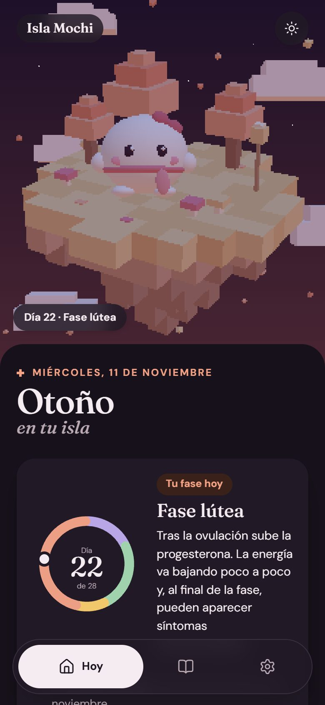</td>
    <td width="33%"></td>
  </tr>
  <tr>
    <td align="center"><sub>Hoy: tu fase primero</sub></td>
    <td align="center"><sub>Modo noche</sub></td>
    <td align="center"><sub>Guía de las cuatro estaciones</sub></td>
  </tr>
  <tr>
    <td></td>
    <td>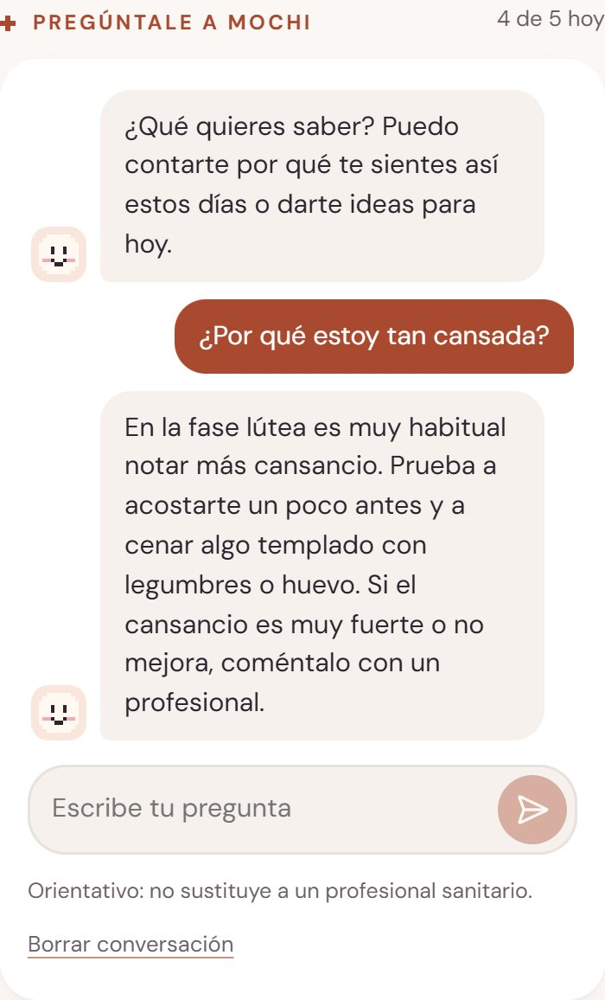</td>
    <td>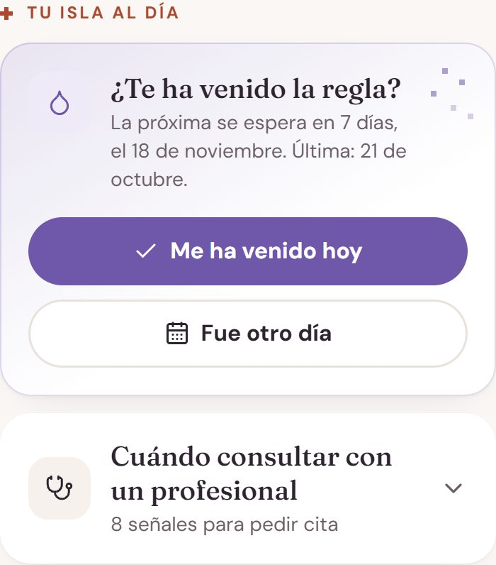</td>
  </tr>
  <tr>
    <td align="center"><sub>Consejos con guía completa y «Para ti»</sub></td>
    <td align="center"><sub>Pregúntale a Mochi, con IA</sub></td>
    <td align="center"><sub>«¿Te ha venido la regla?», en otoño</sub></td>
  </tr>
  <tr>
    <td>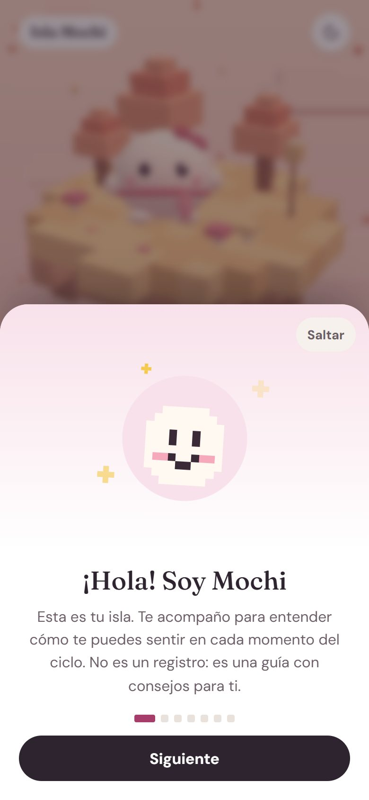</td>
    <td>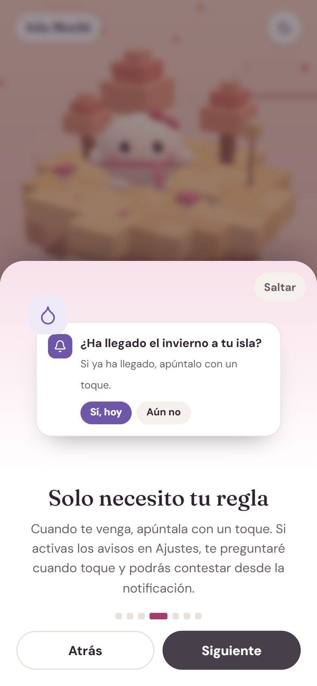</td>
    <td>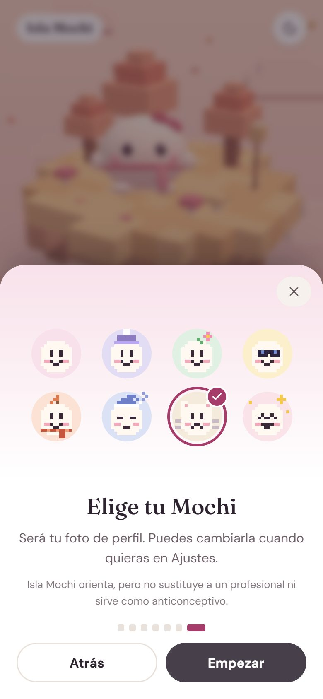</td>
  </tr>
  <tr>
    <td align="center"><sub>Minitutorial para empezar</sub></td>
    <td align="center"><sub>El aviso de la regla</sub></td>
    <td align="center"><sub>Elige tu Mochi</sub></td>
  </tr>
  <tr>
    <td></td>
    <td>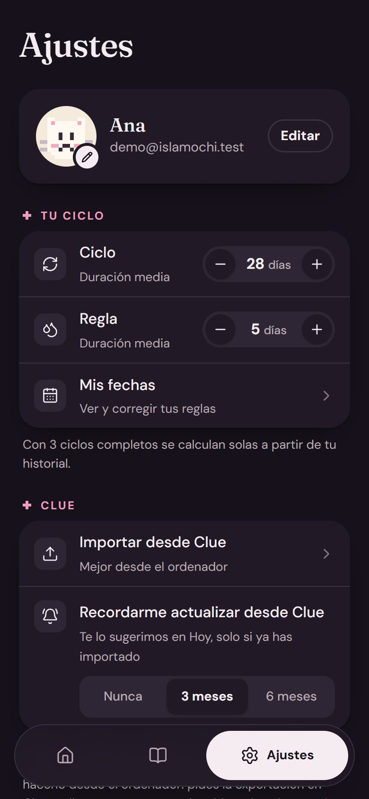</td>
    <td></td>
  </tr>
  <tr>
    <td align="center"><sub>Ajustes</sub></td>
    <td align="center"><sub>Ajustes de noche</sub></td>
    <td align="center"><sub>Importar desde Clue</sub></td>
  </tr>
</table>


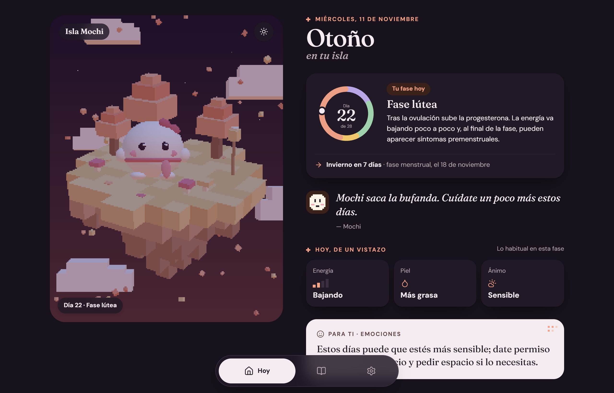

## Las cuatro estaciones

Cada fase es una estación de la isla, y Mochi cambia con ella: más tranquilo y arropado en invierno y otoño, más activo en primavera y verano.

<table>
  <tr>
    <td width="25%"></td>
    <td width="25%"></td>
    <td width="25%"></td>
    <td width="25%"></td>
  </tr>
  <tr>
    <td align="center"><sub><b>Invierno</b><br />Menstrual</sub></td>
    <td align="center"><sub><b>Primavera</b><br />Folicular</sub></td>
    <td align="center"><sub><b>Verano</b><br />Ovulatoria</sub></td>
    <td align="center"><sub><b>Otoño</b><br />Lútea</sub></td>
  </tr>
</table>

Mochi es 3D y está hecho solo con código, sin modelos ni texturas. Respira, parpadea, te sigue con la mirada y da un brinco si lo tocas. De noche, la isla se ilumina con luz de luna bajo un cielo de estrellas.

## Qué hay en la app

### Hoy

- **Tu fase, lo primero.** La isla ocupa la parte de arriba y el contenido sube encima como una hoja. La rueda de estaciones marca tu día del ciclo, y al lado explica la fase en la que estás. Cuándo llega la siguiente va debajo y en pequeño.
- **De un vistazo:** energía, piel y ánimo habituales en tu fase.
- **Cómo te puedes sentir.** Seis temas: emociones, energía, cuerpo, piel y pelo, comida y movimiento. Cada uno tiene un resumen de una línea y, al abrirlo, una guía completa:
  - **Por qué pasa.**
  - **Qué puedes hacer:** tres consejos concretos, numerados.
  - **Cuándo prestar atención,** si hace falta.
- **Consejos «Para ti»:** salen de tu historial de Clue o, si la activas, de la IA.
- **Pregúntale a Mochi:** un chat con IA que tiene en cuenta tu fase y lo que has registrado.
- **Tu isla al día.**
  - **«¿Te ha venido la regla?»** se destaca solo en otoño (fase lútea) o si hay retraso. El resto del ciclo queda plegada y discreta, por si hay que corregir algo.
  - **Apuntarla:** con un toque en «Me ha venido hoy», o eligiendo otro día.
  - **«Cuándo consultar con un profesional»:** las señales de alarma. Se abre sola y se marca en rojo si hace falta.

### Guía

Las cuatro estaciones para curiosear aunque no sea la tuya. Cada estación es una tarjeta con su color, su icono y sus días. Al elegir una:
- La isla 3D cambia de estación y Mochi habla.
- Aparece una gráfica orientativa de estrógenos y progesterona, con tu fase resaltada y la marca de «hoy».
- Hay pestañas por tema con la guía completa y botones para pasar a la estación anterior o siguiente.

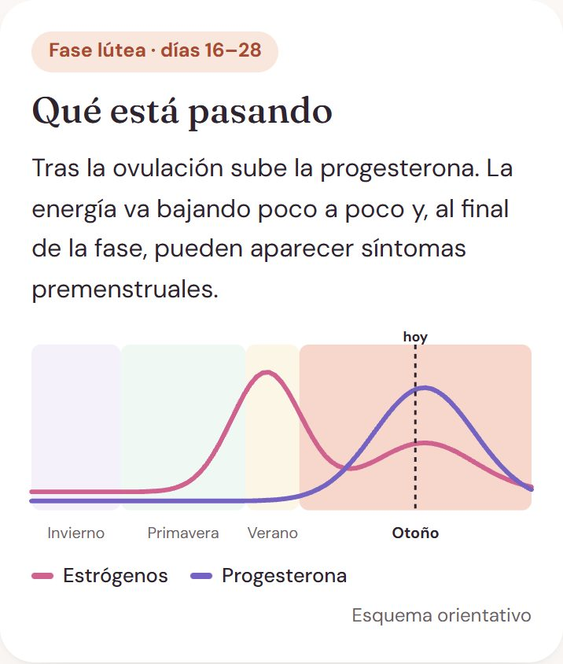 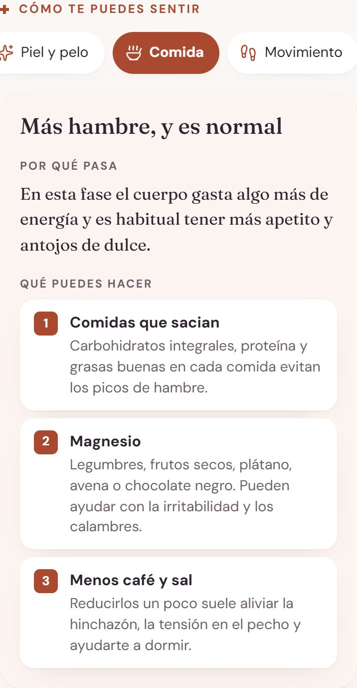

### Para empezar


- **Portada:** presenta la isla y deja ver las cuatro estaciones antes de crear la cuenta.

- **Minitutorial:** siete pantallas con Mochi que explican la app. Sale una sola vez a las usuarias nuevas y se puede volver a ver en Ajustes > Ayuda.
- **Elige tu Mochi:** ocho avatares en píxeles como foto de perfil (clásico, con gorro de lana, con flor, con gafas de sol, con bufanda, dormilón, gatito y estrellita), o tu inicial.
- **Pantalla de carga:** Mochi riega una planta que brota, florece y le hace dar un saltito.

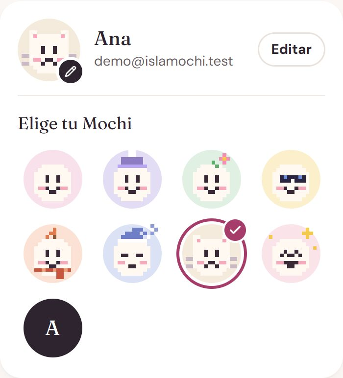 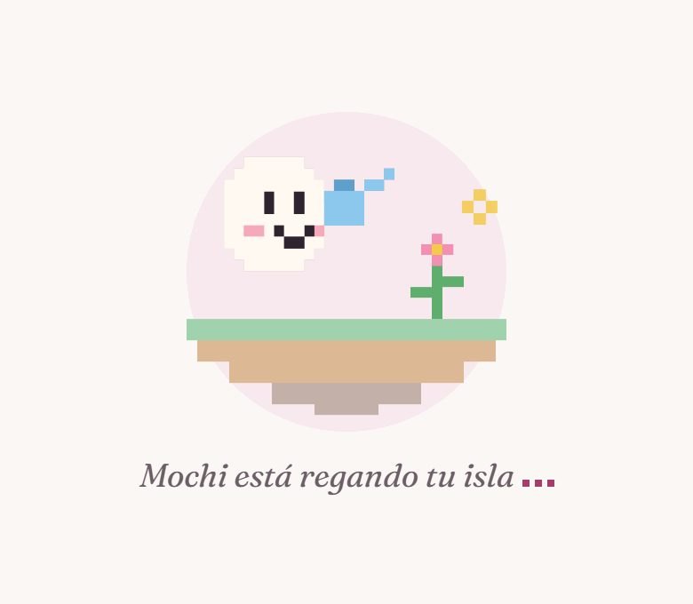

### Día y noche

El modo noche cambia la paleta a tonos ciruela, pone estrellas en el cielo y luz de luna en la isla, y usa colores propios para cada estación. Se elige en el botón de la isla o en Ajustes > Apariencia: automático (sigue al móvil), día o noche. Se aplica antes de pintar la página, así que no hay destello blanco.

## Cómo funciona

1. **Le dices dónde estás.** Indicas tu última regla y tus duraciones medias, o importas tu historial de Clue. El archivo se procesa en tu dispositivo y solo se guardan las fechas de regla y los síntomas.
2. **Mochi calcula tu fase.** Estima en qué día y fase estás, y avisa si tus ciclos son irregulares o si hay retraso.
3. **Lees cómo te puedes sentir.** Información y consejos por tema, con la guía completa en Hoy y en la Guía.
4. **Solo apuntas la regla.** No hay registro diario: el seguimiento lo haces en Clue. Cuando toca, Mochi te pregunta si ha llegado.
5. **Recibes avisos, si los activas.** Por email o notificación, cada día o solo al cambiar de estación. Los títulos no mencionan tu ciclo, por si se ven en la pantalla de bloqueo.

## IA en la nube

Mochi escribe consejos a tu medida y responde preguntas con una IA en la nube. Funciona en el móvil y en el ordenador, sin descargar nada. Es gratis para las usuarias, con un límite diario.


### Cómo funciona

1. **La activas tú.** Antes de enviar nada, la app explica qué datos se envían y a quién, y pide tu permiso. Se guarda la fecha y se puede retirar en Ajustes.
2. **El servidor prepara el contexto.** El navegador solo envía tu sesión y, en el chat, tus mensajes. El servidor lee tus datos con tu propia sesión, así que Row Level Security sigue aplicando. A partir de ellos construye un resumen mínimo: fase, día del ciclo, duraciones medias, lo registrado los últimos 7 días y lo que sueles registrar en esa fase en ciclos anteriores.
3. **Llama al proveedor.** La clave solo existe en el servidor. Los consejos se piden como JSON con esquema estricto, partiendo de las pautas revisadas de cada fase (`src/content/guides.ts`).
4. **Todo se valida.** Se descarta un consejo si:
   - nombra medicamentos o diagnósticos,
   - cambia de idioma,
   - se pasa de largo,
   - o anima a entrenar fuerte a quien lleva días sin energía.

   En el chat, una respuesta con dosis se cambia por una recomendación de consultar con un profesional.
5. **Si falla, no se nota.** Sin IA, sin cupo o con una respuesta no válida, se usan los consejos por reglas.

**Lo que nunca hace la IA:**
- **Decidir sobre señales de alarma.** Si registras dolor o sangrado muy fuertes, el aviso de consultar sale de reglas fijas.
- **Responder ante una crisis.** Si alguien escribe sobre hacerse daño, el chat responde al momento con el 024 y el 112, sin llamar a la IA.
- **Intervenir en los avisos.** Los emails y las notificaciones no usan IA.

### Proveedor y modelo

Usa [Groq](https://console.groq.com) con `openai/gpt-oss-120b`. Se eligió revisando su documentación (noviembre de 2026):

| Modelo | Estado | Límite gratuito | Notas |
|---|---|---|---|
| **openai/gpt-oss-120b** | **Producción** | **1.000 peticiones y 200.000 tokens al día** | **Admite JSON con esquema estricto. Buen español** |
| openai/gpt-oss-20b | Producción | 1.000 peticiones y 200.000 tokens al día | Más rápido, menos capaz |
| llama-3.3-70b-versatile | Producción | No aparece en la tabla gratuita | Sin esquema JSON estricto |
| qwen/qwen3.8-27b | En pruebas | 1.000 peticiones al día | Se puede retirar con poco aviso |

En la prueba real con una usuaria inventada, los consejos tardan alrededor de 1 segundo y cada respuesta del chat, menos de 2.

**El proveedor se puede cambiar sin tocar código.** La conexión (`api/_lib/ai/provider.ts`) sirve para cualquier servicio compatible con la API de chat de OpenAI: basta con cambiar `AI_BASE_URL`, `AI_MODEL` y `AI_API_KEY`. Con `AI_PROVIDER=mock` responde con textos fijos, sin conexión.

### Límites gratuitos

| Límite | Por defecto | Variable |
|---|---|---|
| Preguntas al chat por usuaria y día | 5 | `AI_CHAT_DAILY` |
| Tandas de consejos por usuaria y día | 1 | `AI_ADVICE_DAILY` |
| Peticiones al proveedor al día, entre todas | 900 | `AI_GLOBAL_REQUESTS_DAILY` |
| Tokens al día, entre todas | 180.000 | `AI_GLOBAL_TOKENS_DAILY` |

- **Desde el servidor:** los cupos se controlan con funciones atómicas de Postgres (`ai_take`, `ai_global_take`…) que solo puede usar el servidor.
- **Se renuevan solos:** los de cada usuaria, a medianoche en su zona horaria; los globales, cada día.
- **A la vista:** la app muestra cuántas preguntas te quedan y cuándo vuelven.
- **Si un envío falla,** se devuelve el cupo.
- **Por debajo del plan gratis:** los topes globales quedan por debajo de los límites de Groq. Si aun así Groq responde que ha llegado al límite (429), la IA se pausa para todas el tiempo que indique, sin reintentos.
- **Sin cargos:** no hay ningún mecanismo que active un plan de pago.

### Privacidad de la IA

- **Lo que se envía:** fase, día del ciclo, duraciones medias, síntomas, ánimo y energía de los últimos días, y tus mensajes del chat. Nunca nombre, email, notas, fechas exactas ni identificadores. Hay tests que lo comprueban.
- **Las conversaciones** se guardan solo en tu dispositivo. En la base de datos solo se anota cuántas consultas haces al día y la fecha de tu permiso.
- **Groq** procesa los datos en Estados Unidos. Por defecto no conserva las peticiones, salvo registros de hasta 30 días para depurar o investigar abusos. Para no conservar nada hay que activar **Zero Data Retention** en [Data Controls](https://console.groq.com/settings/data-controls). La política de privacidad lo explica.
- **Las pruebas se hacen con datos inventados:** `tests/ai.live.test.ts` en local, y `api/ai/selftest` en producción, protegido con `CRON_SECRET`.

### Antes: IA en el navegador

La primera versión usaba [WebLLM](https://webllm.mlc.ai) con Qwen3 4B dentro del navegador. Pedía descargar 2,3 GB y una tarjeta gráfica, así que no funcionaba en móviles. Se probaron cinco modelos que sí cabían en un móvil y daban consejos incoherentes o peligrosos. Al pasar a la nube se retiró por completo, y la app borra el modelo a quien lo hubiera descargado.

## Privacidad

Son datos de salud, una categoría especial del RGPD:

- Consentimiento explícito al registrarse, y otro aparte para la IA. Solo se guarda lo necesario.
- Cada usuaria solo puede acceder a sus propias filas, con Row Level Security y tests que lo comprueban.
- Puedes exportar tus datos y borrar tu cuenta desde Ajustes.
- Las fuentes van alojadas en la propia app: no se envía tu IP a Google.

## Estado

| Fase | Contenido | Estado |
|---|---|---|
| 1 | Base, Supabase, auth, bienvenida manual, lógica del ciclo, pantalla Hoy y escena 3D | Hecha |
| 2 | Importar desde Clue y personalización por reglas | Hecha |
| 3 | PWA, push, emails y cron. Exportar y borrar cuenta | Hecha y probada con servicios reales |
| 4 | Identidad visual, modo noche, Guía nueva, tutorial y avatares | Hecha |
| 5 | Sin registro diario. Aviso de la regla con botones y recordatorio de Clue | Hecha |
| 6 | IA en la nube con Groq: consejos, chat y límites gratuitos | Hecha y probada en producción |

## Stack

| Tecnología | Uso |
|---|---|
| React + Vite + TypeScript | Interfaz y build |
| React Three Fiber + drei + Three.js | Escena 3D |
| React Router | Rutas |
| Fraunces + DM Sans + lucide | Tipografía e iconos, alojados en la app |
| Supabase | Auth (magic link y código) y Postgres con Row Level Security |
| Groq + gpt-oss-120b | Consejos y chat con IA desde el servidor, en el plan gratuito |
| zip.js | Abrir en el navegador el ZIP con contraseña de Clue |
| Vitest + PGlite | Tests de la lógica, de las políticas RLS y de los cupos de la IA |
| Brevo | Correos de acceso y de avisos, sin dominio propio |
| web-push + service worker | Notificaciones con botones y PWA instalable |
| Vercel | Hosting, funciones de `api/` y cron diario |

## Empezar en local

Requisitos: Node.js 20 o superior. Los comandos son para PowerShell.

```powershell
npm install
npm run dev:demo
```

La web queda en `http://localhost:5180` en **modo demo**:
- **Sin claves ni servicios:** los datos se guardan en la pestaña del navegador, no se envía ningún correo y vale cualquier código.
- **IA simulada:** responde con textos fijos y respeta los mismos límites.
- **Herramientas en Hoy:** una barra plegada permite saltar a cualquier estación o simular un retraso.

Este modo solo existe en desarrollo y no llega al build de producción. Con `npm run dev` y las claves de Supabase en `.env.local`, la app se conecta al proyecto real.

| Script | Qué hace |
|---|---|
| `npm run dev:demo` | Servidor de desarrollo en modo demo, en el puerto 5180 |
| `npm run dev` | Servidor de desarrollo con Supabase |
| `npm run build` | Comprueba los tipos (web, service worker y `api/`) y genera `dist/` |
| `npm run preview` | Sirve el build para probarlo |
| `npm test` | Tests de lógica, RLS, avisos y cupos de la IA |
| `npm run lint` | Revisa el código con ESLint |

Para probar la IA real con una usuaria inventada, pon `AI_API_KEY` en `.env.local` y ejecuta:

```powershell
$env:AI_LIVE = "1"; npx.cmd vitest run tests/ai.live.test.ts --reporter=verbose
```

## Conectar Supabase

1. Crea un proyecto en [supabase.com](https://supabase.com). **Elige una región de la UE**: la región no se puede cambiar después.
2. Aplica las migraciones de `supabase/migrations/` en orden, con `npx.cmd supabase db push` o pegándolas en *SQL Editor*.
3. En *Authentication > URL Configuration*, pon la URL de la app en *Site URL* y añádela en *Redirect URLs* (`http://localhost:5173/**` en local).
4. Las plantillas de correo están en `supabase/templates/` e incluyen el código de 6 dígitos, que hace falta porque en iPhone el enlace se abre en Safari y no en la app instalada.
5. Crea tu archivo local y rellena los valores de *Project Settings > API*:

```powershell
Copy-Item .env.example .env.local
```

> Hasta conectar un SMTP propio, Supabase solo envía 2 correos por hora y únicamente a miembros de tu organización.

### Correos sin dominio propio

1. Crea una cuenta en [brevo.com](https://www.brevo.com) y verifica como remitente un correo creado solo para la app.
2. En Brevo, genera una clave SMTP y una clave API. Desactiva el bloqueo por IP de las claves API, porque Vercel no tiene una IP fija.
3. En Supabase, entra en *Authentication > Emails > SMTP Settings*, activa el SMTP propio y usa `smtp-relay.brevo.com`, puerto 587, tu usuario SMTP de Brevo y la clave SMTP como contraseña.
4. Sube el límite de correos por hora en *Authentication > Rate Limits*.

### IA gratuita con Groq

1. Crea una cuenta gratuita en [console.groq.com](https://console.groq.com), sin añadir ningún método de pago.
2. Activa **Zero Data Retention** en [Data Controls](https://console.groq.com/settings/data-controls).
3. Crea una clave en [API Keys](https://console.groq.com/keys) y guárdala solo en el servidor, como `AI_API_KEY` en Vercel, marcada como *Sensitive*.

## Variables de entorno

| Variable | Dónde | Para qué |
|---|---|---|
| `VITE_SUPABASE_URL` | `.env.local` y Vercel | URL del proyecto |
| `VITE_SUPABASE_ANON_KEY` | `.env.local` y Vercel | Clave pública. Lo que protege los datos es RLS |
| `VITE_VAPID_PUBLIC_KEY` | `.env.local` y Vercel | Clave pública de notificaciones |
| `SUPABASE_SERVICE_ROLE_KEY` | **Solo Vercel** | Se salta RLS. Para el cron, los cupos de la IA y borrar cuentas |
| `VAPID_PRIVATE_KEY` | **Solo Vercel** | Clave privada de notificaciones |
| `VAPID_SUBJECT` | **Solo Vercel** | Contacto, por ejemplo `mailto:hola@tudominio.es` |
| `BREVO_API_KEY` | **Solo Vercel** | Clave de la API de Brevo |
| `BREVO_SENDER_EMAIL` | **Solo Vercel** | Remitente verificado en Brevo |
| `APP_URL` | **Solo Vercel** | URL pública, sin barra final |
| `CRON_SECRET` | **Solo Vercel** | Protege el cron, el aviso de prueba y la prueba de la IA |
| `UNSUBSCRIBE_SECRET` | **Solo Vercel** | Firma los enlaces de baja y el botón «Sí, hoy» |
| `AI_API_KEY` | **Solo Vercel** (y `.env.local` para probar) | Clave del proveedor de IA. Sin ella, la IA aparece como no disponible |
| `AI_BASE_URL`, `AI_MODEL` | Vercel, opcionales | Cambiar de proveedor o de modelo |
| `AI_CHAT_DAILY`, `AI_ADVICE_DAILY` | Vercel, opcionales | Límites diarios por usuaria |
| `AI_GLOBAL_REQUESTS_DAILY`, `AI_GLOBAL_TOKENS_DAILY` | Vercel, opcionales | Topes diarios entre todas |

Todo lo que lleva el prefijo `VITE_` llega al navegador: nunca pongas ahí una clave secreta.

## Base de datos

Las migraciones están en `supabase/migrations/`.

| Tabla | Contenido |
|---|---|
| `profiles` | Duraciones medias, avisos, zona horaria, consentimientos (salud e IA) y avatar. La crea un trigger al registrarse |
| `periods` | Fechas de regla, apuntadas o importadas de Clue. Una por usuaria y día, así reimportar no duplica |
| `daily_logs` | Síntomas importados de Clue. Las notas antiguas se conservan y nunca se envían a la IA |
| `push_subscriptions` | Dispositivos con avisos push |
| `notification_log` | Avisos enviados. Solo la usa el servidor |
| `ai_usage`, `ai_global_usage` | Cupos diarios de la IA. Solo los usa el servidor |

Cada usuaria solo puede leer y escribir sus filas. Todo cuelga de `auth.users` con `on delete cascade`, de modo que borrar la cuenta borra sus datos. `tests/rls.test.ts` y `tests/aiQuota.test.ts` ejecutan las migraciones reales en un Postgres en memoria y comprueban este aislamiento.

## Lógica del ciclo

Vive en `src/lib/cycle.ts`, sin dependencias de interfaz, para poder usarla también en el servidor.

- Las fechas son cadenas `YYYY-MM-DD`, sin horas, para evitar errores de zona horaria.
- La duración media se calcula con los últimos 6 ciclos cuando hay al menos 3 completos. Si no, se usa la que indicó la usuaria.
- La ovulación se estima en (duración − 14) ± 1 día. Con ciclos cortos y reglas largas, la ventana empieza el día después de la regla y la fase folicular puede quedarse sin días.
- Estados especiales: `late` (retraso), `stale` (más de 30 días de retraso, pide actualizar), `no_data`, y aviso de ciclo irregular si la variación pasa de 7 días.

## Personalización por reglas

Vive en `src/lib/personalize.ts`, sin IA ni red. Usa los síntomas importados de Clue.

- **Reglas:** si una señal aparece al menos 2 de los últimos 5 días, se añade un consejo «Para ti».
- **Patrones:** un síntoma registrado en la misma fase de 2 ciclos anteriores se avisa en el bloque Cuerpo.
- **Alarma:** dolor o sangrado muy fuertes muestran durante 3 días la recomendación de consultar con un profesional.

## Importar desde Clue

Clue no tiene una API pública y Clue Connect solo comparte el ciclo con otra persona que use Clue, así que los datos se traen con su exportación. Es más cómodo desde el ordenador: la exportación se pide en la app de Clue, llega por correo como un ZIP con contraseña y se sube en Ajustes > Importar desde Clue.

Todo ocurre en el navegador. `src/lib/clue/read.ts` abre el ZIP o el JSON y solo descifra `measurements.json`. `src/lib/clue/parser.ts` extrae las fechas de regla y una lista cerrada de síntomas: el resto, como vida sexual, medicación o peso, se descarta sin guardarse.

Si has importado alguna vez, Hoy te sugiere actualizar cada 3 meses. Se puede cambiar a 6 meses o desactivar en Ajustes, o decir «No volver a preguntar» en la propia tarjeta.

## Avisos

`vercel.json` llama una vez al día, sobre las 7:00 UTC, a `api/cron/daily.ts`, protegido con `CRON_SECRET`. Para cada usuaria calcula la fase en su zona horaria y envía email, push o ambos, sin IA.

- **Pregunta de la regla.** El día en que se espera la regla, y otra vez a los 3 y 7 días si no se ha apuntado, llega «¿Ha llegado el invierno a tu isla?».
  - **En Android y en el ordenador:** la notificación lleva los botones «Sí, hoy» y «Aún no». «Sí, hoy» apunta la fecha sin abrir la app, con una petición firmada solo para esa usuaria y ese día (`api/period-start.ts`).
  - **En iPhone:** los botones pueden no aparecer, y la notificación abre Hoy.
- **Discreción:** el asunto y el push se ven en la pantalla de bloqueo, así que usan la metáfora de la isla y nunca mencionan el ciclo. Hay un test que lo comprueba.
- **Sin duplicados:** cada envío se reserva antes en `notification_log`. Si el cron se repite, no se envía dos veces.
- **Límite de Brevo:** como mucho 200 emails al día, con prioridad para la pregunta de la regla y los cambios de estación.
- **Baja:** cada email lleva un enlace firmado. Abrirlo solo pregunta, porque algunos correos abren los enlaces solos.

Genera las claves de notificaciones y los secretos así:

```powershell
npx.cmd web-push generate-vapid-keys
```

```powershell
node -e "console.log(require('crypto').randomBytes(32).toString('hex'))"
```

`npm run dev` no ejecuta `api/` ni el service worker. Para probar las funciones usa `npx.cmd vercel dev`, y para la PWA, `npm run build` y `npm run preview`.

## Estructura

```
├── api/                     Funciones de Vercel
│   ├── ai/                  IA: status, advice, chat y selftest
│   ├── cron/daily.ts        Avisos diarios
│   ├── period-start.ts      Botón «Sí, hoy» de la notificación
│   └── _lib/                Lógica de avisos, plantillas, conexiones y la IA (no son rutas)
│       └── ai/              Proveedor, contexto, prompts, cupos y Supabase
├── public/                  Iconos de la PWA e imágenes de los correos
├── supabase/                Migraciones, plantillas de correo y config.toml
├── tests/                   Ciclo, reglas, Clue, avisos, RLS, guías y cupos de la IA
└── src/
    ├── components/          CycleDial, MochiFace, MochiAvatar, MochiChat, Tutorial, HormoneChart...
    ├── content/             phases.ts, guides.ts, personalTips.ts, glance.ts, symptoms.ts y legal.ts
    ├── hooks/               useSession, useCycleData, useAiAdvice, useVisible, useReveal
    ├── lib/                 cycle.ts, personalize.ts, theme.ts, tutorial.ts, clueReminder.ts, clue/ y ai/
    ├── pages/               Landing, Auth, Onboarding, Today, Guide, MyCycle, ImportClue, Install, Settings, Privacy
    ├── services/            supabase.ts, auth.ts, data.ts, push.ts, account.ts y demo.ts
    ├── sw.ts                Service worker: caché de la web y notificaciones con botones
    ├── styles/index.css     Tokens de día y noche, y todos los estilos
    └── three/               Scene, Island, Mochi, Floaters, Burst, seasons, shapes, support
```

## Personalizar

| Qué quieres cambiar | Dónde |
|---|---|
| Colores de día y de noche, tipografías | Tokens de `:root`, `[data-phase]` y `[data-theme="dark"]` en `src/styles/index.css` |
| Resumen y frases de cada fase | `src/content/phases.ts` |
| Guía de cada tema (por qué pasa, consejos, cuándo prestar atención) | `src/content/guides.ts` |
| Consejos por reglas | `src/content/personalTips.ts` |
| Prompts y validación de la IA | `api/_lib/ai/prompts.ts` y `src/lib/ai/advice.ts` |
| Proveedor, modelo y límites de la IA | Variables `AI_*` en Vercel |
| Pantallas del tutorial | `src/components/Tutorial.tsx` |
| Avatares de Mochi | `src/components/MochiAvatar.tsx` |
| Caras de Mochi en píxeles | `src/components/MochiFace.tsx` |
| Colores de cada estación y energía de Mochi en 3D | `src/three/seasons.ts` |
| Aspecto y ropa de Mochi en 3D | `src/three/Mochi.tsx` |
| Responsable de la política de privacidad | `src/content/legal.ts` |

## Rendimiento 3D

La escena se dibuja a baja resolución y se amplía con `image-rendering: pixelated`, lo que da el aspecto retro y reduce mucho el trabajo de la GPU. Funciona a 30 fps con `frameloop="demand"`, se pausa fuera de pantalla y usa muy pocos polígonos. Three.js se descarga aparte, después del contenido. Sin WebGL o con «reducir movimiento» activado se muestra `StaticIsland`.

## Despliegue

1. Sube el repositorio a GitHub e impórtalo en Vercel.
2. Añade todas las variables de la tabla en *Settings > Environment Variables*.
3. Añade la URL de producción en *Redirect URLs* de Supabase.

Si un cambio toca la base de datos, aplica primero la migración en Supabase y después despliega.

## Ideas para el futuro

- **Gimnasio y fuerza:** información sobre entrenar con pesas a lo largo del ciclo, según tus intereses.

## Antes de abrirla al público

- Rellenar el responsable en `src/content/legal.ts` y hacer revisar la política de privacidad, incluida la transferencia de datos a Groq (Estados Unidos).
- Que alguien con formación sanitaria revise las guías de `src/content/guides.ts` y los prompts de la IA.
- Comprobar que **Zero Data Retention** sigue activado en Groq.
- Sin dominio propio, algunos correos pueden llegar a spam.
- El plan gratuito de Supabase no incluye copias de seguridad automáticas: exporta los datos con `supabase db dump` o valora el plan Pro.
